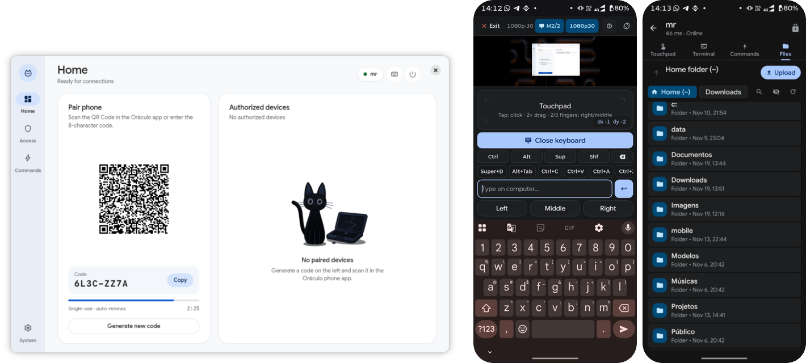
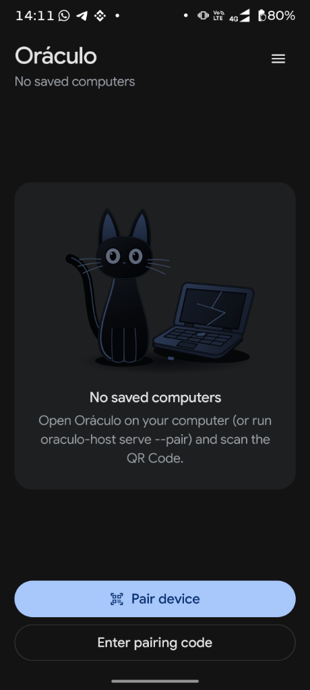
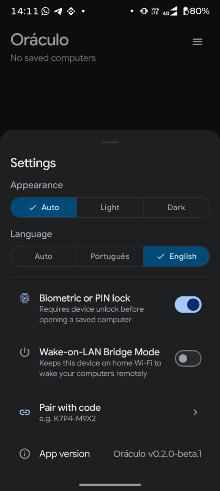

<h1 align="center">Oráculo</h1>

<p align="center">
  Control your Linux computer from your Android phone: screen, terminal, files, and Wake-on-LAN.<br>
  Encrypted peer-to-peer. No account, no cloud login, no router port forwarding.
</p>

<p align="center">
  <a href="https://github.com/marcos-ce/Oraculo-Desk/releases"></a>
  <a href="https://github.com/marcos-ce/Oraculo-Desk/actions/workflows/ci.yml"></a>
  <a href="LICENSE"></a>
  <a href="README.pt-BR.md"></a>
</p>

<p align="center">
  
</p>

> **Beta (v0.2.0-beta.1).** Linux host (Wayland) + Android client. Screen streaming needs a Wayland session; Windows, macOS, and iOS are not available yet. See [Limitations](#limitations).

## What it does

- **Screen & input:** live H.264 screen with touchpad, direct touch, pinch-to-zoom, and multi-monitor switching.
- **Terminal:** persistent multi-tab shells that survive reconnects.
- **Quick commands:** one-tap shortcuts, edited on desktop or phone.
- **Files:** browse, download, and upload, confined to your home directory.
- **Lock-screen unlock:** over an encrypted local RDP tunnel.
- **Wake-on-LAN:** on your network, or from anywhere through a [bridge](docs/wake-on-lan.md).

## Download

Get the latest build from [Releases](https://github.com/marcos-ce/Oraculo-Desk/releases):

| Platform | File | Requirements |
| :--- | :--- | :--- |
| **Linux** (x86_64) | `oraculo-v*-linux-x86_64.tar.gz` | Wayland + PipeWire, WebKitGTK, GStreamer H.264 |
| **Android** (arm64) | `oraculo-v*-android-arm64.apk` | Android 8.0+ |

Verify downloads with `sha256sum -c SHA256SUMS-*.txt`.

**Linux:**

```bash
tar xzf oraculo-v*-linux-x86_64.tar.gz
install -Dm 755 oraculo-desktop oraculo-host oraculo-bridge oraculo-cli -t ~/.local/bin/
install -Dm 644 com.oraculo.Desktop.desktop -t ~/.local/share/applications/
install -Dm 644 com.oraculo.Desktop.svg -t ~/.local/share/icons/hicolor/scalable/apps/

# Fedora: video encoding dependencies
sudo dnf install gstreamer1-plugins-base pipewire-gstreamer gstreamer1-plugin-openh264
```

NVIDIA GPUs use `nvh264enc` when available; otherwise Oráculo falls back to `openh264enc`.

**Android:** copy the `.apk` to your phone and install it (allow unknown sources if prompted).

## Quick start

1. **Computer:** open **Oráculo** from your app menu. The **Home** tab shows a single-use QR Code and 8-character code.
2. **Phone:** open the app, tap **Pair device**, and scan the QR Code (or tap **Enter pairing code**).
3. **Control:** use the **Touchpad**, **Terminal**, **Commands**, and **Files** tabs. Permissions can be toggled at any time in the desktop **Access** tab.

<table>
  <tr>
    <td align="center"><br><sub>Pair with a QR Code or code</sub></td>
    <td align="center"><br><sub>Biometric lock, theme, language, WoL bridge mode</sub></td>
  </tr>
</table>

## Security

- End-to-end encrypted QUIC (TLS 1.3, Ed25519 keys) via [`iroh`](https://www.iroh.computer/). Connections are direct when possible; otherwise encrypted traffic passes through public relays that cannot read it.
- Pairing codes are single-use and expire in 3 minutes. Removing a device or disabling a permission ends active sessions immediately.
- File access cannot leave `~`, and sensitive paths (`.ssh`, `.gnupg`, keyrings, shell startup files) are blocked.
- Optional biometric/PIN lock in the Android app.

Details in the [security model](docs/security.md). Report vulnerabilities privately via [`.github/SECURITY.md`](.github/SECURITY.md).

## Limitations

- **Beta software.** The tested setup is GNOME on Wayland (Fedora) + Android arm64. KDE Plasma and other Wayland desktops are untested or lightly tested.
- **X11 sessions:** terminal, commands, files, and Wake-on-LAN work; screen streaming and remote input do not.
- **Locked screen / GDM login:** Wayland blocks screen capture, so unlocking uses an external Android RDP client (`aFreeRDP` or `Windows App`).
- **Platforms:** Linux x86_64 host and Android arm64 client only. Windows is next on the roadmap; macOS and iOS are planned.
- **Remote Wake-on-LAN** needs a bridge: `oraculo-bridge`, a spare Android phone, or an [ESP32 / Cardputer](firmware/oraculo-wol-esp32/README.md).

Full matrix and roadmap: [Platform support](docs/compatibility.md).

## Documentation

- [Wake-on-LAN guide](docs/wake-on-lan.md) · [ESP32 bridge firmware](firmware/oraculo-wol-esp32/README.md)
- [Command-line usage](docs/cli.md) (`oraculo-host`, `oraculo-cli`, `oraculo-bridge`)
- [Security model](docs/security.md) · [Platform support & roadmap](docs/compatibility.md)

## Building from source

Builds run in [Podman](https://podman.io/) containers with the pinned Rust toolchain, Android SDK 35, and NDK:

```bash
git clone https://github.com/marcos-ce/Oraculo-Desk.git && cd Oraculo-Desk
./scripts/build.sh test           # workspace tests
./scripts/build.sh release        # host, desktop, bridge, cli → ./dist/
./scripts/build-android.sh debug  # Android APK → ./dist/
```

## License

[Apache License 2.0](LICENSE). Third-party notices and font licenses are in [`NOTICE`](NOTICE).
