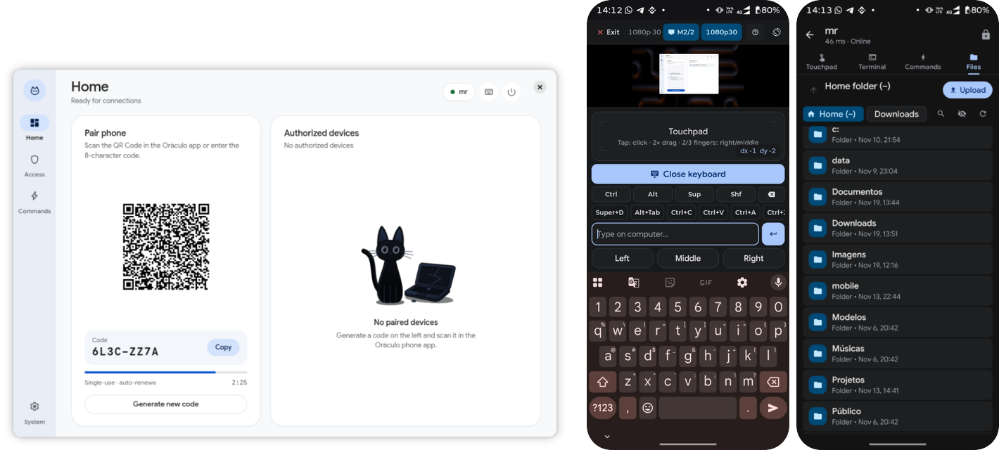
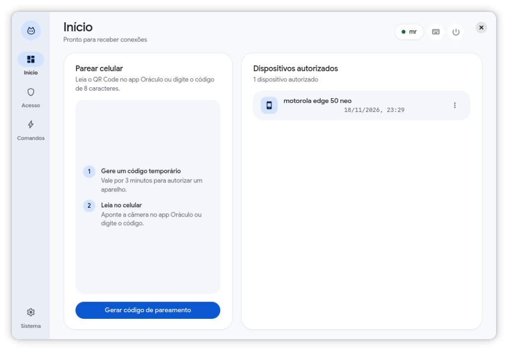
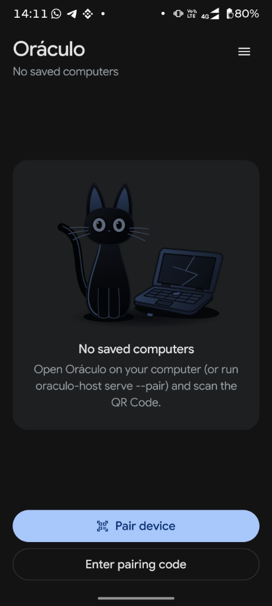
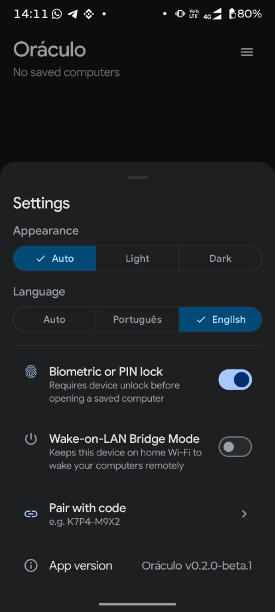
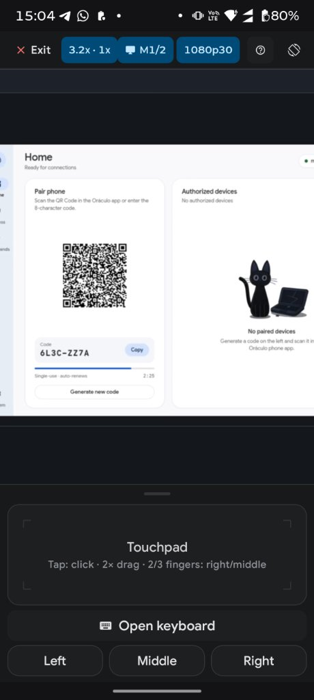

<h1 align="center">Oráculo</h1>

<p align="center">
  Controle seu computador Linux pelo celular Android: tela, terminal, arquivos e Wake-on-LAN.<br>
  P2P criptografado. Sem conta, sem login em nuvem, sem abrir portas no roteador.
</p>

<p align="center">
  <a href="https://github.com/marcos-ce/Oraculo-Desk/releases"></a>
  <a href="https://github.com/marcos-ce/Oraculo-Desk/actions/workflows/ci.yml"></a>
  <a href="LICENSE"></a>
  <a href="README.md"></a>
</p>

<p align="center">
  
</p>

> Beta (v0.2.0-beta.1). Host Linux (Wayland) + cliente Android. A transmissão de tela exige sessão Wayland; Windows, macOS e iOS ainda não estão disponíveis. Veja as [Limitações](#limitações).

## O que faz

- Vídeo H.264 ao vivo com touchpad, toque direto, zoom por pinça e troca de monitor.
- Shells persistentes em abas que sobrevivem a reconexões.
- Atalhos de um toque, editáveis no computador ou no celular.
- Navegador de arquivos com download e envio, restrito à sua pasta pessoal.
- Desbloqueio de tela por túnel RDP local criptografado.
- Wake-on-LAN na sua rede ou de qualquer lugar por meio de uma [ponte](docs/wake-on-lan.pt-BR.md).

## Download

Baixe a versão mais recente em [Releases](https://github.com/marcos-ce/Oraculo-Desk/releases):

| Plataforma | Arquivo | Requisitos |
| :--- | :--- | :--- |
| **Linux** (x86_64) | `oraculo-v*-linux-x86_64.tar.gz` | Wayland + PipeWire, WebKitGTK, GStreamer H.264 |
| **Android** (arm64) | `oraculo-v*-android-arm64.apk` | Android 8.0+ |

Verifique os downloads com `sha256sum -c SHA256SUMS-*.txt`.

**Linux:**

```bash
tar xzf oraculo-v*-linux-x86_64.tar.gz
install -Dm 755 oraculo-desktop oraculo-host oraculo-bridge oraculo-cli -t ~/.local/bin/
install -Dm 644 com.oraculo.Desktop.desktop -t ~/.local/share/applications/
install -Dm 644 com.oraculo.Desktop.svg -t ~/.local/share/icons/hicolor/scalable/apps/

# Fedora: dependências de codificação de vídeo
sudo dnf install gstreamer1-plugins-base pipewire-gstreamer gstreamer1-plugin-openh264
```

Placas NVIDIA usam `nvh264enc` quando disponível; nos demais casos, o Oráculo usa `openh264enc`.

**Android:** copie o `.apk` para o celular e instale (permita fontes desconhecidas se o sistema solicitar).

## Primeiros passos

1. **Computador:** abra o **Oráculo** pelo menu de aplicativos. A aba **Início** mostra um QR Code de uso único e um código de 8 caracteres.
2. **Celular:** abra o app, toque em **Parear dispositivo** e aponte a câmera para o QR Code (ou toque em **Digitar código de pareamento**).
3. **Controle:** use as abas **Touchpad**, **Terminal**, **Comandos** e **Arquivos**. As permissões podem ser alteradas a qualquer momento na aba **Acesso** do desktop.

<table>
  <tr>
    <td align="center"><br><sub>Dispositivo autorizado no computador</sub></td>
    <td align="center"><br><sub>Pareamento por QR Code ou código</sub></td>
    <td align="center"><br><sub>Bloqueio biométrico, tema, idioma, modo ponte WoL</sub></td>
    <td align="center"><br><sub>Tela ao vivo com controle por touchpad</sub></td>
  </tr>
</table>

> Os screenshots do Android estão com o idioma em inglês; o app também está disponível em português.

## Segurança

- QUIC criptografado ponta a ponta (TLS 1.3, chaves Ed25519) via [`iroh`](https://www.iroh.computer/). A conexão é direta quando possível; caso contrário, o tráfego cifrado passa por relays públicos que não conseguem lê-lo.
- Códigos de pareamento são de uso único e expiram em 3 minutos. Remover um aparelho ou desativar uma permissão encerra as sessões ativas na hora.
- O acesso a arquivos não sai de `~`, e caminhos sensíveis (`.ssh`, `.gnupg`, keyrings, arquivos de inicialização do shell) são bloqueados.
- Bloqueio opcional por biometria/PIN no app Android.

Detalhes no [modelo de segurança](docs/security.pt-BR.md). Reporte vulnerabilidades de forma privada via [`.github/SECURITY.md`](.github/SECURITY.md).

## Limitações

- **Software em beta.** O cenário testado é GNOME no Wayland (Fedora) + Android arm64. KDE Plasma e outros ambientes Wayland não foram testados ou tiveram testes limitados.
- **Sessões X11:** terminal, comandos, arquivos e Wake-on-LAN funcionam; transmissão de tela e controle remoto não.
- **Tela bloqueada / login do GDM:** o Wayland bloqueia a captura de tela, então o desbloqueio usa um cliente RDP externo no Android (`aFreeRDP` ou `Windows App`).
- **Plataformas:** apenas host Linux x86_64 e cliente Android arm64. O Windows é a próxima prioridade; macOS e iOS estão planejados.
- **Wake-on-LAN remoto** exige uma ponte: `oraculo-bridge`, um celular Android sobrando ou um [ESP32 / Cardputer](firmware/oraculo-wol-esp32/README.md).

Matriz completa e roadmap: [Suporte de plataformas](docs/compatibility.pt-BR.md).

## Documentação

- [Guia de Wake-on-LAN](docs/wake-on-lan.pt-BR.md) · [Firmware da ponte ESP32](firmware/oraculo-wol-esp32/README.md)
- [Uso por linha de comando](docs/cli.pt-BR.md) (`oraculo-host`, `oraculo-cli`, `oraculo-bridge`)
- [Modelo de segurança](docs/security.pt-BR.md) · [Suporte de plataformas e roadmap](docs/compatibility.pt-BR.md)

## Compilando do código-fonte

As compilações rodam em contêineres [Podman](https://podman.io/) com a toolchain Rust fixada, Android SDK 35 e NDK:

```bash
git clone https://github.com/marcos-ce/Oraculo-Desk.git && cd Oraculo-Desk
./scripts/build.sh test           # testes do workspace
./scripts/build.sh release        # host, desktop, bridge, cli → ./dist/
./scripts/build-android.sh debug  # APK Android → ./dist/
```

## Licença

[Apache License 2.0](LICENSE). Avisos de terceiros e licenças de fontes estão em [`NOTICE`](NOTICE).
